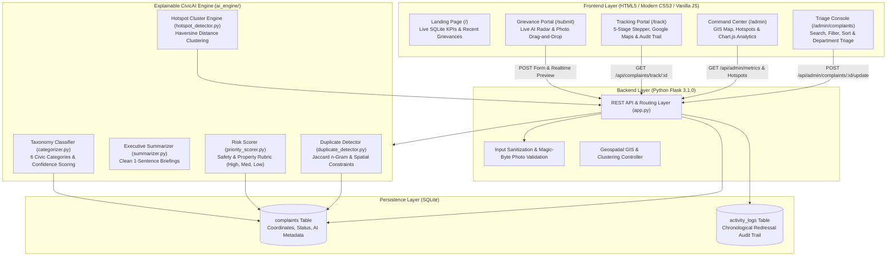

# CivicAI – Smart Citizen Complaint Management System

[](https://www.python.org/)
[](https://flask.palletsprojects.com/)
[](https://www.sqlite.org/)
[](https://leafletjs.com/)
[](https://www.chartjs.org/)

CivicAI is a full-stack smart municipal grievance redressal platform engineered for modern cities. Powered by transparent NLP algorithms and geospatial intelligence, CivicAI delivers automated intake triage, category classification, executive issue summaries, duplicate complaint suppression, multi-factor safety priority scoring, and GIS hotspot clustering.

---

## 🏛️ System Architecture



---

## 🌟 Key Features

1. **Modern Dark Navy & Teal Visual Identity**:
   - High-contrast, responsive user experience (`#060b19` navy, `#00e5bc` teal, `#0ea5e9` sky blue).
   - Fully optimized for desktop, tablets, and mobile smartphones.
   - Interactive Chart.js analytics, animated priority status badges, and pulsating radar map pins.

2. **Citizen Submission Portal with Real-Time AI Radar (`/submit`)**:
   - Fields: Citizen Name, Category Selection, Location, Detailed Description, and Photo Upload.
   - **Live Triage Radar**: Evaluates grievance as the citizen types with zero latency, displaying predicted category, confidence score, suggested department, priority score, and duplicate alerts.
   - Genuine image magic-byte validation (JPEG, PNG, GIF, WEBP) preventing malicious file uploads.

3. **High-Clarity Google Maps & GIS Hotspot Engine**:
   - Built on Leaflet.js with high-resolution Google Maps layers (Google Streets, Google Satellite/Hybrid, Google Terrain) and OpenStreetMap.
   - Layer control switcher allows 1-click toggling between vector street map and photorealistic satellite imagery.
   - Priority-coded marker pins (Red for High, Amber for Medium, Green for Low) with animated pulsing radar rings.
   - Dynamic hotspot circles showing municipal cluster radius, complaint density, and severity.
   - Direct **"Open in Google Maps"** navigation button on every marker for turn-by-turn driving directions.

4. **Transparent Citizen Grievance Tracking (`/track`)**:
   - Lookup by unique alphanumeric Tracking ID (e.g., `CIV-2026-SYN01`) or database ID.
   - Interactive 5-stage lifecycle stepper: `Submitted` &rarr; `Under Review` &rarr; `Assigned` &rarr; `In Progress` &rarr; `Resolved`.
   - Dedicated Field Geolocation Map centering directly on the incident with a 250m municipal response perimeter.
   - Full chronological audit trail with timestamp, actor (`Citizen`, `CivicAI Engine`, `Municipal Officer`), action title, and official remarks.
   - Green **Grievance Remediated & Resolved** completion banner displayed upon case closure.

5. **Executive Command Dashboard (`/admin`)**:
   - Real-time KPI widgets: Total Complaints, Pending Grievances, Resolved Cases, Urgent High-Priority Alerts.
   - 3 dynamic Chart.js visualizations (Status Doughnut, Priority Breakdown, Category Distribution).
   - Hotspot Intelligence side panel ranking active clusters by severity.

6. **Operations & Triage Console (`/admin/complaints`)**:
   - Multi-filter controls: instant search, category dropdown, priority filter, sort order, and status filter buttons.
   - Full administrative modal to update status, route to municipal departments, appoint field engineers, and append official audit remarks.

---

## 🧠 Explainable AI Approach

CivicAI rejects opaque "black box" claims in favor of transparent, interpretable, deterministic NLP and spatial logic that municipal administrators can audit and explain to citizens:

1. **Taxonomy Categorization (`ai_engine/categorizer.py`)**:
   - Analyzes grievance text across 6 municipal sectors: `Road Damage`, `Waterlogging`, `Garbage`, `Streetlight`, `Drainage`, and `Other`.
   - Weighted stemmed n-gram scoring produces confidence percentages and human-readable justification strings (e.g. *"Classified under Road Damage based on keywords: 'crater', 'pothole', 'broken asphalt'"*).

2. **Safety Priority Scoring (`ai_engine/priority_scorer.py`)**:
   - Multi-factor safety rubric evaluating:
     - Public Safety Hazards (0–35 pts)
     - Residential & Property Risk (0–25 pts)
     - Temporal Urgency & Inconvenience (0–20 pts)
     - Category Severity Baseline (0–20 pts)
   - Generates transparent, bulleted justifications (e.g., *Risk to residential properties; Potential safety hazard; Immediate attention required*).

3. **Spatial & Textual Duplicate Detection (`ai_engine/duplicate_detector.py`)**:
   - Combines Jaccard token overlap, bigram shingling, and spatial distance constraints.
   - Prevents false duplicates across distant wards by penalizing scores if complaints occur in separate neighborhoods, while flagging identical nearby complaints to avoid duplicate dispatch.

4. **GIS Hotspot Clustering (`ai_engine/hotspot_detector.py`)**:
   - Uses Haversine great-circle distance clustering ($\le 850\text{m}$) to detect high-density grievance zones with $\ge 2$ complaints.
   - Computes cluster centroid, dynamic visual radius, dominant category, and severity rating.

---

## ⚠️ Limitations & Future Roadmap

- **Predefined Category Taxonomy**: Current implementation covers 6 core civic domains. Future versions can incorporate hierarchical subcategories (e.g. Pothole vs. Bridge Joint).
- **Rule-Based NLP**: Fast, zero-dependency, and 100% explainable without GPU requirements. Future iterations can optionally connect local quantized LLMs (e.g. Llama 3 or Gemma) for multilingual vernacular translation.
- **Client GPS Fallback**: In desktop testing where GPS hardware is absent or permission is denied, coordinates default to metropolitan demonstration clusters.

---

## 💻 Exact macOS Terminal Run Instructions

Follow these exact steps to run CivicAI on macOS:

### 1. Open Terminal and Navigate to Project
```bash
cd /Users/mallappasdodli/hakaton
```

### 2. Activate Virtual Environment
```bash
source venv/bin/activate
```

### 3. Install Dependencies (if not already installed)
```bash
pip install -r requirements.txt
```

### 4. Initialize Database with 40 Synthetic Demonstration Records
```bash
python database/seed_data.py
```

### 5. Run the Automated Verification Test Suites
```bash
python test_competition_demo.py
python test_workflow.py
```
*(Both should output `OK` confirming all 12 competition requirements are met.)*

### 6. Launch the CivicAI Server
```bash
python app.py
```

### 7. Open in Your Browser
- **Citizen Portal**: [http://127.0.0.1:5001](http://127.0.0.1:5001)
- **Report a Problem**: [http://127.0.0.1:5001/submit](http://127.0.0.1:5001/submit)
- **Track Status**: [http://127.0.0.1:5001/track](http://127.0.0.1:5001/track)
- **Admin Command Dashboard**: [http://127.0.0.1:5001/admin](http://127.0.0.1:5001/admin)
- **Complaint Management Console**: [http://127.0.0.1:5001/admin/complaints](http://127.0.0.1:5001/admin/complaints)

*(Note: On macOS, Port 5000 is often reserved by AirPlay Receiver. CivicAI automatically detects this and binds cleanly to Port 5001 or 5050).*

---

## 🔍 Demonstration Tracking IDs for Quick Testing

Use these pre-seeded synthetic IDs on the [Track Status Page](http://127.0.0.1:5001/track):
- `CIV-2026-SYN01` — **In Progress**: Severe residential waterlogging on Indiranagar 5th Main.
- `CIV-2026-SYN02` — **Duplicate Flagged**: Matches `SYN01` with duplicate alert banner.
- `CIV-2026-SYN10` — **High Priority**: Dangerous highway crater on Outer Ring Road.
- `CIV-2026-SYN26` — **Urgent Safety**: Sparking live wire near primary school gate.
- `CIV-2026-SYN40` — **Resolved**: Certified road repair with full 5-stage completed audit trail.

---

## 📄 License & Academic Note
Built for civic hackathons and municipal technology competitions. All sample data is synthetic and contains zero real personal information.
